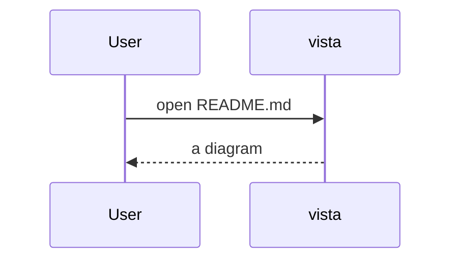

# 25 · Mermaid diagrams

A ```` ```mermaid ```` block in a Markdown file shows as the diagram, not its source, as on GitHub. vista draws it with [merman](https://crates.io/crates/merman), a Rust implementation of Mermaid (the one Zed uses), so it needs no browser, Node or `mmdc`.

````markdown

````

## What it shows

- **A picture** where the terminal shows real pixels (kitty graphics: Ghostty, kitty, WezTerm): every diagram type Mermaid has (flowcharts, sequence, class, state, ER, pie, gantt, mindmap, …), fitted to the pane's width and at most its height, in Mermaid's dark theme on a dark look and its default theme on a light one, on the look's background.
- **Text** otherwise, drawn with box-drawing characters in the text flow (selectable, searchable, copyable):

  ```
  ┌──────┐           ┌───────┐
  │ User │           │ vista │
  └───┬──┘           └───┬───┘
      │ open README.md   │
      ├─────────────────►│
  ```

  Half-block images (terminals without kitty graphics) are too coarse for a diagram's labels, so there it's text too. Text covers flowcharts, sequence, class, state and ER diagrams and XY charts; shapes it can't draw yet (pie charts, flowcharts whose lines would cross) show the source as a code block.
- **The source** as a code block for an invalid diagram, with images off and no text form, or with `m` (raw Markdown).

A picture is made in the background: the text shows first, and the picture takes its place when ready (the first one takes about a second while fonts load, the next a few milliseconds). Each is made once per diagram and look; changing the look makes new ones. `Shift-L` line numbers point at the line after the fence.

## Settings

None of its own. `[images] protocol` decides: `kitty` (or `auto` finding kitty graphics) gives pictures, `halfblocks` and `off` give text ([03](03-markdown-and-images.md#settings)).

## Code and tests

- `vista-render/src/mermaid.rs` (`text`, cached per source and width; `png`), `Renderer::mermaid_block` in `markdown.rs` (picture, text or source; `MdLine::diagram` marks a diagram still to be made), `MdPictures` and `draw_markdown` in `vista-tui/src/ui/viewer.rs` (sizes, cache keys per look, the background job), the `MdImageDecoded` handler in `app.rs` (records the size, lays Markdown out again).
- Unit: fences, keys, text and PNG output, types without text (`mermaid`); text until there's a picture, the picture's rows, source for a pie (`markdown`).
- E2e: `e2e_r1_mermaid.rs` (text and source with half-blocks, `m`; a kitty picture replacing both).

See also: [03 · Markdown and images](03-markdown-and-images.md).
