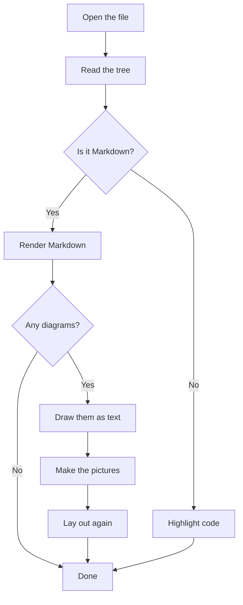
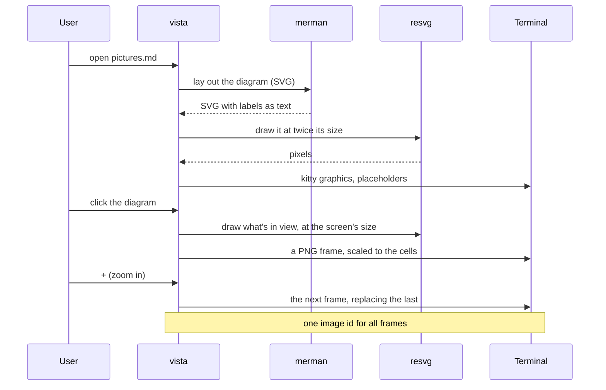
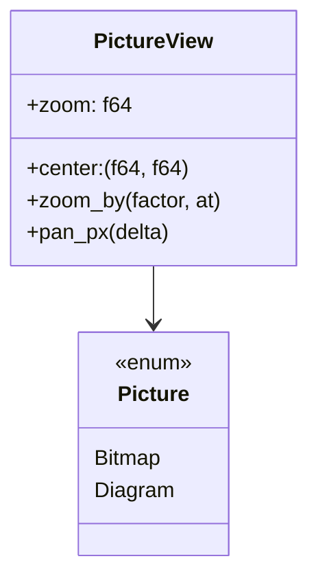
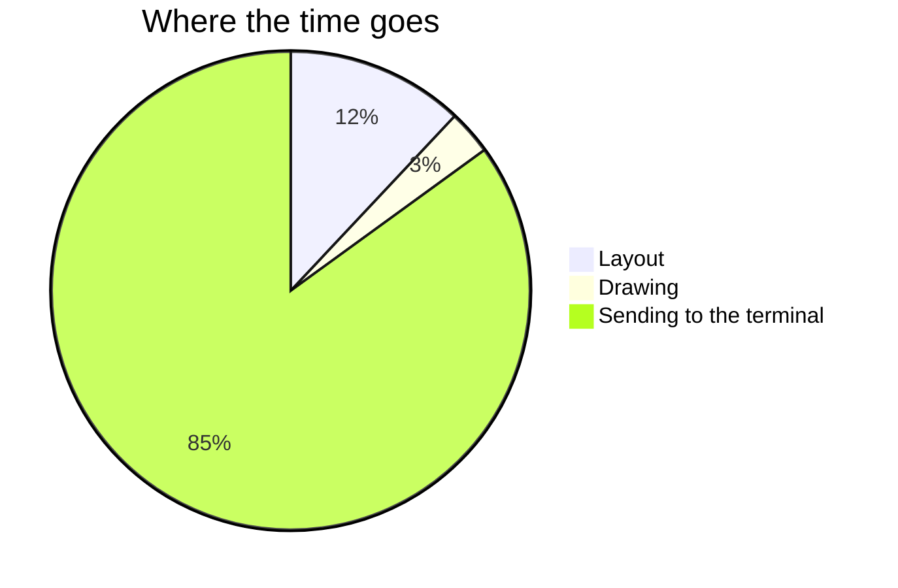
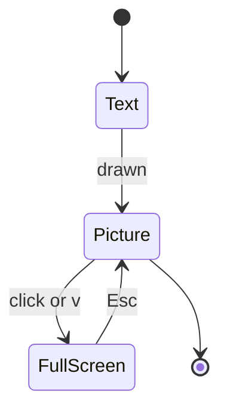

# Manual check: pictures and diagrams

The PTY tests can't see what a real terminal draws. Before a release, open
this file in vista in the terminal you use every day (Ghostty, inside herdr
too) and go through the list:

```sh
cargo build --release -p vista-tui
target/release/vista docs/manual-checks/pictures.md
```

1. **Diagrams appear.** Every diagram below shows as a picture (the
   "invalid" one shows its source), on the look's background, in its colours.
2. **Scrolling.** Scroll slowly through the tall flowchart: as it moves off
   the top or bottom, the part still in view stays drawn (nothing blinks out).
3. **Open full screen.** Click the wide diagram: it fills the screen, sharp.
   The top row shows "Mermaid diagram", the zoom in percent and the keys.
4. **Zoom.** `+` a few times, then the wheel over a label: the text stays
   sharp and the point under the mouse stays put. `-` back, `0` fits.
5. **Move.** Arrow keys, `h` `j` `k` `l`, dragging: the view moves and stops
   at the edges.
6. **Close.** `Esc`: the document is back, **with its diagrams still drawn**.
   Open and zoom a few more times (`v` opens the first picture in view), close
   again: still drawn.
7. **Another look.** `Ctrl-T` to a light look and back: diagrams are redrawn
   in its colours.
8. **Without kitty graphics** (optional): `VISTA_IMAGE_PROTOCOL=halfblocks
   target/release/vista docs/manual-checks/pictures.md`: diagrams show as
   box-drawing text where they have a text form (sequence, classes,
   states), the others (the tall flowchart, the pie chart) as source.

If something's off, `~/Library/Caches/vista/vista.log` has the terminal's
image protocol, cell size and capabilities from the start of the run.

## A tall flowchart (scrolling)



## A wide, detailed diagram (zooming)



## Classes



## A pie chart (no text form: source without kitty graphics)



## States



## An invalid diagram (shows its source)

```mermaid
flowchart TD
  A -->
```
